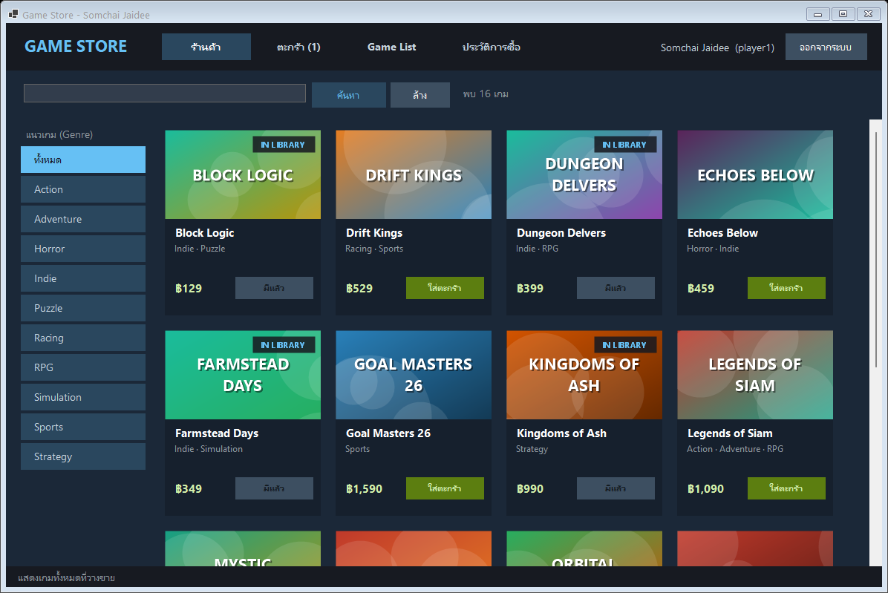

# Online Game Store (OGS)

โปรเจกต์วิชา **CP353 System Analysis and Design** (มศว, ภาคเรียนที่ 1/2026) — **โจทย์ B : Online Game Store**

ร้านขายเกมออนไลน์แบบ Steam/GOG: ลูกค้าค้นหาเกมตามชื่อหรือ genre ใส่ตะกร้า ชำระเงินผ่าน**ธนาคารจำลอง**
มี **Game List** ของตัวเอง และขอคืนเงินได้



## Technology (ตามที่วิชากำหนด)

| Layer | Technology | Project |
|---|---|---|
| Presentation Layer | **C# WinForms** (.NET 10) + HttpClient | `GameStore.Client` |
| Domain Layer | **ASP.NET Core 10 (REST API)** | `GameStore.Api` |
| Data Access Layer | **Entity Framework Core 10** (Npgsql) | `GameStore.DataAccess` |
| Database | **PostgreSQL 18** | `database/*.sql` |

## วิธี Run (ครั้งแรก)

### 1) สร้าง Database ด้วย pgAdmin4

1. เปิด **Query Tool** ของ database `postgres` (login ด้วย user `postgres`)
2. เปิดไฟล์ [`database/1_create_database.sql`](database/1_create_database.sql) แล้ว **highlight ทีละคำสั่ง** และกด F5 (`CREATE ROLE` แล้วตามด้วย `CREATE DATABASE`)
3. Refresh แล้วเปิด **Query Tool** ของ database `gamestore` จากนั้นรัน [`database/2_create_tables.sql`](database/2_create_tables.sql) **ทั้งไฟล์**
   - ไฟล์นี้รันซ้ำได้ทุกเมื่อ ถ้าต้องการ **reset ข้อมูล**กลับเป็นค่าเริ่มต้น

### 2) Run ใน Visual Studio

1. เปิด `GameStore.slnx`
2. คลิกขวาที่ Solution → **Configure Startup Projects...** → เลือก **Multiple startup projects**
   - `GameStore.Api` → **Start**
   - `GameStore.Client` → **Start**
3. กด **F5** หน้าต่าง login ของ Client จะเปิดขึ้น และ API จะ run ที่ `http://localhost:5080`

> ถ้า connection string ไม่ตรงกับเครื่อง ให้แก้ที่ `GameStore.Api/appsettings.json`
> ถ้า Client ต่อ API ไม่ได้ ให้ตรวจ `BaseUri` ใน `GameStore.Client/appsettings.json`

หรือ run ผ่าน command line (เปิด 2 terminal):

```bash
dotnet run --project GameStore.Api --launch-profile http
```

```bash
dotnet run --project GameStore.Client
```

## ข้อมูลทดสอบ

| Username | Password | สถานะเริ่มต้น |
|---|---|---|
| `player1` | `pass1234` | มี 4 เกมใน Game List (ใช้ทดสอบกฎคืนเงินได้ครบทุกกรณี), มี 1 เกมในตะกร้า |
| `player2` | `pass1234` | Game List ว่าง, ในตะกร้ามีเกมราคา ฿1,590 |

| บัญชีธนาคาร (จำลอง) | ยอดเงิน | ใช้ทดสอบ |
|---|---|---|
| `111-1-11111-1` | 5,000 | ซื้อสำเร็จ |
| `222-2-22222-2` | 300 | **เงินไม่พอ** → HTTP 402 |
| `999-9-99999-9` | 100,000 | บัญชีเงินเยอะ |

### สถานการณ์สาธิต (Demo Script)

1. login `player2` → ตะกร้า → ชำระเงินด้วยบัญชี `222-2-22222-2` → **ถูกปฏิเสธเพราะเงินไม่พอ** (ไม่มี order เกิดขึ้น ตะกร้ายังอยู่ครบ)
2. เปลี่ยนเป็นบัญชี `999-9-99999-9` → ชำระสำเร็จ → เกมเข้า Game List
3. login `player1` → Game List: มีเกม 4 แบบที่สิทธิ์คืนเงินต่างกัน
   - *Farmstead Days* คืนเงินได้
   - *Kingdoms of Ash* เล่นไปแล้ว 5 ชม. จึงคืนไม่ได้
   - *Block Logic*, *Dungeon Delvers* ซื้อมาเกิน 14 วัน จึงคืนไม่ได้
4. กด "เล่น" ที่ Farmstead Days 3 ครั้ง (เวลาเล่นรวมครบ 2 ชม.) จะเห็นว่าสิทธิ์คืนเงินหายไป
5. ร้านค้า → ค้นหา "star" / กด genre "Horror" → ใส่ตะกร้า → ชำระเงิน → ขอคืนเงิน → ดูประวัติ

## โครงสร้าง Project

```
Project SASD/
├── GameStore.slnx
├── database/
│   ├── 1_create_database.sql      สร้าง ROLE + DATABASE
│   ├── 2_create_tables.sql        สร้าง TABLE + test data (รันซ้ำเพื่อ reset ได้)
│   └── gamestore.dbml             ER diagram สำหรับ dbdiagram.io
│
├── GameStore.Client/              ── Presentation Layer (Client Tier) ──
│   ├── Forms/                     LoginForm, MainForm, GameDetailForm, CheckoutForm, RefundForm
│   ├── UI/                        Theme, GameCard, CoverPainter (วาดปกเกม)
│   ├── Services/                  RestUtil (HttpClient), StoreApi (ทุก end point), MyConfig, Session
│   └── appsettings.json           BaseUri ของ API
│
├── GameStore.Contracts/           DTO (รูปแบบ JSON) ที่ใช้ร่วมกันระหว่าง Client กับ API
│
├── GameStore.Api/                 ── Domain Layer (Server Tier) ──
│   ├── Controllers/               REST end points (บาง ๆ ส่งต่อให้ Service)
│   ├── Domain/Services/           Business logic: Account, Catalog, Cart, Purchase, Library, Refund
│   ├── Domain/Rules/              RefundPolicy, PasswordHasher (pure functions)
│   ├── Domain/DomainException.cs  ความผิดพลาดทาง business
│   ├── ErrorHandling/             แปลง DomainException → HTTP status code
│   ├── Program.cs                 ตั้งค่า DI, EF, OpenAPI
│   ├── appsettings.json           connection string (อยู่ฝั่ง server เท่านั้น)
│   └── GameStore.Api.http         ทดสอบ API ใน Visual Studio
│
├── GameStore.DataAccess/          ── Data Access Layer ──
│   ├── Models/                    Entity classes จากการ scaffold + Model.cs (constructors)
│   ├── GameStoreContext.cs        DbContext จากการ scaffold
│   ├── GameStoreContext.Custom.cs ส่วนที่เขียนเพิ่ม (connection string, snake_case)
│   └── Gateways/                  IBankGateway + SimulatedBankGateway (ธนาคารจำลอง)
│
├── GameStore.Tests/               Unit tests (xUnit)
│
└── docs/                          เอกสารและ diagrams
```

## เอกสารการออกแบบ

| เอกสาร | เนื้อหา |
|---|---|
| [docs/01-use-cases.md](docs/01-use-cases.md) | Requirements, Actors, **Use Case Diagram**, Use Case Descriptions (Kite / Sea level), Business Rules |
| [docs/02-architecture.md](docs/02-architecture.md) | Architectural Decisions 4 ข้อ, 3 Layer กับ 3 Tier, **C4 Model ครบ 4 ระดับ**, Data Access Pattern, Sequence Diagram |
| [docs/03-database.md](docs/03-database.md) | **ER Diagram**, การออกแบบตาราง, EF Scaffolding, LINQ ที่ใช้ |
| [docs/04-rest-api.md](docs/04-rest-api.md) | **REST API Design**, end points ทั้งหมด, status codes |
| [docs/05-ai-usage.md](docs/05-ai-usage.md) | การใช้ AI และผลลัพธ์ (ฉบับร่าง ให้กลุ่มทบทวน) |

ไฟล์ต้นฉบับของ diagram (แก้ไขได้ด้วยเครื่องมือที่ใช้ในวิชา):

| Diagram | ไฟล์ต้นฉบับ | เครื่องมือ | ภาพ |
|---|---|---|---|
| C4 Context / Container / Component | [docs/c4/workspace.dsl](docs/c4/workspace.dsl) | playground.structurizr.com | [png](docs/diagrams/png) / [svg](docs/diagrams) |
| C4 Code (Class Diagram) | [docs/uml/code-diagram.puml](docs/uml/code-diagram.puml) | PlantUML | `c4-4-code` |
| Use Case Diagram | [docs/uml/use-case.puml](docs/uml/use-case.puml) | PlantUML | `use-case` |
| ER Diagram | [database/gamestore.dbml](database/gamestore.dbml) | dbdiagram.io | `er-diagram` |
| Sequence Diagram (Checkout) | Mermaid ใน [docs/02-architecture.md](docs/02-architecture.md) | GitHub / VS Code | `sequence-checkout` |
| Domain Model (Class) | Mermaid ใน [docs/03-database.md](docs/03-database.md) | GitHub / VS Code | `domain-model` |

> ภาพ PNG ทั้งหมดอยู่ใน `docs/diagrams/png/` (ความละเอียด 2x ใส่ Word ได้เลย) และภาพหน้าจอโปรแกรมอยู่ใน `docs/screenshots/`
> ไฟล์ `workspace.dsl` และ `.puml` ยังไม่ได้ทดสอบด้วยเครื่องมือจริง ควรวางใน playground/PlantUML ดูก่อนส่ง 1 ครั้ง

## Tests

```bash
dotnet test
```

มี 13 unit tests สำหรับกฎการคืนเงิน (`RefundPolicy`) และการ hash รหัสผ่าน (`PasswordHasher`)

## หมายเหตุ

- รหัสผ่าน database (`GameStore01f2e2fa`) อยู่ใน `appsettings.json` เพื่อให้ run ได้ง่ายตามแบบในวิชา ถ้าเป็นระบบจริงควรเก็บใน environment variable หรือ user-secrets
- ยังไม่มี authentication token (ดูข้อจำกัดใน [docs/04-rest-api.md](docs/04-rest-api.md))
