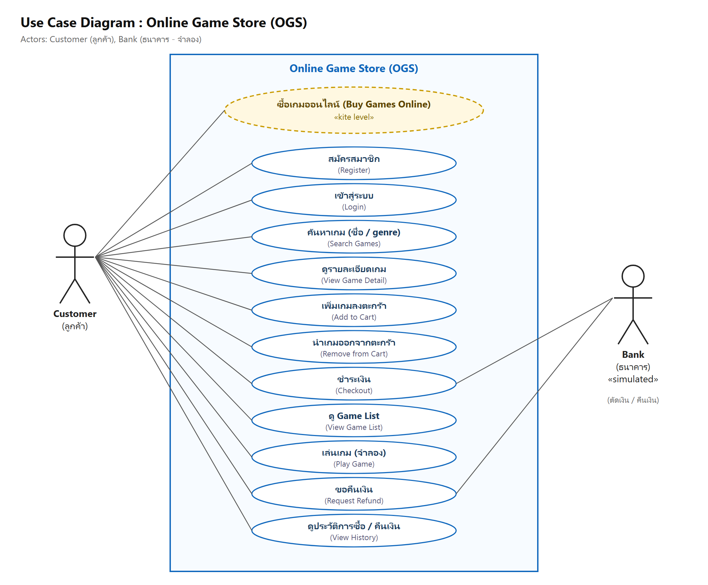

# 1. Requirements และ Use Cases

## โจทย์ B : Online Game Store

ตัวอย่างระบบจริง: Steam, GOG

| ประเภท | Requirement | สถานะ |
|---|---|---|
| ขั้นต่ำ | ลูกค้าเลือกซื้อเกมได้ (จำลองการตัดเงินจากธนาคาร ไม่ต้องเชื่อมต่อจริง) | ✅ ตะกร้า + ชำระเงินผ่านธนาคารจำลอง |
| ขั้นต่ำ | ลูกค้ามี Game List | ✅ หน้า Game List (คลังเกม) |
| เพิ่มเติม | การค้นหาเกมตามความสนใจ | ✅ ค้นหาตามชื่อเกม + กดเลือก genre |
| เพิ่มเติม | การขอคืนเงิน (refund) | ✅ คืนเงินได้ภายใน 14 วัน และเล่นไม่ถึง 2 ชั่วโมง |
| เพิ่มเติม (ออกแบบเอง) | ตะกร้าสินค้า | ✅ ใส่หลายเกมแล้วจ่ายครั้งเดียว |
| ไม่ได้ทำ | ส่วนเพิ่มเกมสำหรับผู้ขาย | ❌ (ข้อมูลเกมใส่ผ่าน SQL script) |

## Actors

| Actor | ประเภท | คำอธิบาย |
|---|---|---|
| **Customer (ลูกค้า)** | Primary Actor | ผู้ที่สมัครสมาชิก ค้นหาเกม ซื้อเกม เล่นเกม และขอคืนเงิน |
| **Bank (ธนาคาร)** | Supporting Actor (ระบบภายนอก) | ตัดเงินตอนซื้อ และโอนเงินคืนตอนคืนเงิน *(ในโปรเจกต์นี้เป็นธนาคารจำลอง)* |

> ตามคำแนะนำในชีต 10 หน้า 38 เราใช้คำเดียวกันตลอดสำหรับสิ่งเดียวกัน:
> เรียกผู้ใช้ว่า **Customer** เสมอ, เรียกระบบว่า **ระบบ OGS** (Online Game Store), เรียกคลังเกมว่า **Game List**

## Use Case Diagram

*(ไฟล์ต้นฉบับ: [uml/use-case.puml](uml/use-case.puml) · ภาพ SVG: [diagrams/use-case.svg](diagrams/use-case.svg))*

---

## Use Case Descriptions

### Kite Level

#### UC0 ซื้อเกมออนไลน์ (Buy Games Online)
- **System:** Online Game Store (OGS)
- **Primary Actor:** Customer
- **Goal Level:** Kite Level

1. Customer เข้าสู่ระบบ (UC2)
2. Customer ค้นหาเกมที่สนใจ (UC3) และดูรายละเอียดเกม (UC4)
3. Customer เพิ่มเกมลงตะกร้า (UC5) ทำซ้ำข้อ 2-3 จนได้เกมครบตามต้องการ
4. Customer ชำระเงิน (UC7)
5. Customer เล่นเกมจาก Game List (UC9)
6. ถ้าไม่พอใจเกม Customer ขอคืนเงิน (UC10)

### Sea Level

#### UC1 สมัครสมาชิก (Register)
- **System:** OGS · **Primary Actor:** Customer · **Goal Level:** Sea Level

1. Customer เปิดโปรแกรม แล้วกด "สมัครสมาชิก"
2. Customer กรอก username, รหัสผ่าน, ชื่อที่แสดง และอีเมล
3. ระบบ OGS ตรวจสอบรูปแบบข้อมูล และตรวจว่า username ยังไม่มีผู้ใช้
4. ระบบ OGS บันทึกข้อมูล Customer โดยเก็บรหัสผ่านเป็น hash
5. ระบบ OGS พา Customer เข้าสู่หน้าร้านค้า

**กรณีอื่น:** 3a. username ซ้ำ หรือข้อมูลไม่ถูกต้อง → ระบบ OGS แจ้งข้อผิดพลาด แล้วกลับไปข้อ 2

#### UC2 เข้าสู่ระบบ (Login)
- **System:** OGS · **Primary Actor:** Customer · **Goal Level:** Sea Level

1. Customer กรอก username และรหัสผ่าน
2. ระบบ OGS ตรวจสอบรหัสผ่านกับ hash ที่เก็บไว้
3. ระบบ OGS แสดงหน้าร้านค้า

**กรณีอื่น:** 2a. ข้อมูลไม่ถูกต้อง → ระบบ OGS แจ้ง "ชื่อผู้ใช้หรือรหัสผ่านไม่ถูกต้อง" (ไม่บอกว่าผิดที่ช่องไหน)

#### UC3 ค้นหาเกม (Search Games)
- **System:** OGS · **Primary Actor:** Customer · **Goal Level:** Sea Level

1. Customer พิมพ์ชื่อเกม (หรือบางส่วนของชื่อ) แล้วกด "ค้นหา" และ/หรือ กดเลือก genre ที่สนใจ
2. ระบบ OGS ค้นหาเกมที่วางขายอยู่ ที่ชื่อตรงกับคำค้น (ไม่สนตัวพิมพ์เล็ก-ใหญ่) และอยู่ใน genre ที่เลือก
3. ระบบ OGS แสดงรายการเกม พร้อมราคา และสถานะ (ซื้อได้ / อยู่ในตะกร้า / มีแล้ว)

#### UC4 ดูรายละเอียดเกม (View Game Detail)
- **System:** OGS · **Primary Actor:** Customer · **Goal Level:** Sea Level

1. Customer กดที่เกมในหน้าร้านค้า
2. ระบบ OGS แสดงชื่อเกม ผู้พัฒนา วันวางจำหน่าย genre ราคา และคำอธิบาย

#### UC5 เพิ่มเกมลงตะกร้า (Add to Cart)
- **System:** OGS · **Primary Actor:** Customer · **Goal Level:** Sea Level

1. Customer กด "ใส่ตะกร้า" ที่เกมที่ต้องการ
2. ระบบ OGS ตรวจว่าเกมยังวางขายอยู่ Customer ยังไม่มีเกมนี้ใน Game List และยังไม่อยู่ในตะกร้า
3. ระบบ OGS เพิ่มเกมลงตะกร้า และแสดงจำนวนเกมในตะกร้า

**กรณีอื่น:** 2a. มีเกมนี้แล้ว หรืออยู่ในตะกร้าแล้ว → ระบบ OGS แจ้งเหตุผล และไม่เพิ่มซ้ำ

#### UC6 นำเกมออกจากตะกร้า (Remove from Cart)
- **System:** OGS · **Primary Actor:** Customer · **Goal Level:** Sea Level

1. Customer เปิดหน้าตะกร้า แล้วเลือกเกม
2. Customer กด "นำเกมที่เลือกออกจากตะกร้า"
3. ระบบ OGS ลบเกมออกจากตะกร้า และคำนวณยอดรวมใหม่

#### UC7 ชำระเงิน (Checkout)
- **System:** OGS · **Primary Actor:** Customer · **Supporting Actor:** Bank · **Goal Level:** Sea Level

1. Customer เปิดหน้าตะกร้า แล้วกด "ชำระเงิน"
2. ระบบ OGS แสดงรายการเกมและยอดชำระ
3. Customer เลือกเลขบัญชีธนาคาร แล้วกด "ยืนยันชำระเงิน"
4. ระบบ OGS ตรวจว่าตะกร้าไม่ว่าง เกมทุกเกมยังวางขาย และ Customer ยังไม่มีเกมเหล่านั้น
5. ระบบ OGS ส่งคำขอตัดเงินตามยอดชำระไปยัง Bank
6. Bank ตัดเงินจากบัญชี และส่งเลขอ้างอิงกลับมา
7. ระบบ OGS สร้างคำสั่งซื้อ (เก็บราคา ณ วันที่ซื้อ) เพิ่มเกมเข้า Game List และล้างตะกร้า
8. ระบบ OGS แสดงใบเสร็จ: เลขที่คำสั่งซื้อ ยอดชำระ เลขอ้างอิง และยอดเงินคงเหลือ

**กรณีอื่น:**
- 6a. เงินในบัญชีไม่พอ หรือไม่พบบัญชี → Bank ปฏิเสธ → ระบบ OGS แจ้ง Customer โดย**ไม่สร้างคำสั่งซื้อ**และตะกร้ายังอยู่ครบ แล้วกลับไปข้อ 3
- ข้อ 5-7 ทำใน database transaction เดียวกัน ถ้าขั้นใดล้มเหลว ระบบ OGS จะยกเลิกทั้งหมด (ไม่มีกรณีถูกตัดเงินแต่ไม่ได้เกม — เป็นไปได้เพราะธนาคารจำลองอยู่ใน DB เดียวกัน ดูข้อควรรู้ใน [02-architecture.md §2.4](02-architecture.md#24-data-access-pattern-ที่เลือก-ชีต-11))

#### UC8 ดู Game List (View Game List)
- **System:** OGS · **Primary Actor:** Customer · **Goal Level:** Sea Level

1. Customer กดเมนู "Game List"
2. ระบบ OGS แสดงเกมทั้งหมดที่ Customer มี พร้อมเวลาเล่น วันที่ได้รับ ราคาที่จ่าย และสิทธิ์การคืนเงิน

#### UC9 เล่นเกม (Play Game) *(จำลอง)*
- **System:** OGS · **Primary Actor:** Customer · **Goal Level:** Sea Level

1. Customer เลือกเกมใน Game List แล้วกด "เล่น"
2. ระบบ OGS จำลองการเล่น โดยเพิ่มเวลาเล่น 30 นาที และบันทึกเวลาเล่นล่าสุด
3. ระบบ OGS แสดงเวลาเล่นรวม และสิทธิ์การคืนเงินที่อัปเดตแล้ว

#### UC10 ขอคืนเงิน (Request Refund)
- **System:** OGS · **Primary Actor:** Customer · **Supporting Actor:** Bank · **Goal Level:** Sea Level

1. Customer เลือกเกมใน Game List แล้วกด "ขอคืนเงิน"
2. ระบบ OGS แสดงราคาที่จ่าย เวลาเล่น และกำหนดวันสุดท้ายที่คืนเงินได้
3. Customer ใส่เหตุผล (ไม่บังคับ) แล้วกดยืนยัน
4. ระบบ OGS ตรวจเงื่อนไข: ซื้อมาไม่เกิน 14 วัน, เล่นไม่ถึง 2 ชั่วโมง และยังไม่เคยคืนเงินรายการนี้
5. ระบบ OGS ส่งคำขอคืนเงินไปยัง Bank (เข้าบัญชีเดิมที่ใช้จ่าย)
6. Bank โอนเงินคืน และส่งเลขอ้างอิงกลับมา
7. ระบบ OGS บันทึกการคืนเงิน และนำเกมออกจาก Game List
8. ระบบ OGS แสดงผลการคืนเงิน และยอดเงินคงเหลือ

**กรณีอื่น:** 4a. ไม่ผ่านเงื่อนไข → ระบบ OGS แจ้งเหตุผล (เช่น "เล่นไปแล้ว 5 ชม. 0 นาที") และไม่คืนเงิน

#### UC11 ดูประวัติการซื้อ / คืนเงิน (View History)
- **System:** OGS · **Primary Actor:** Customer · **Goal Level:** Sea Level

1. Customer กดเมนู "ประวัติการซื้อ"
2. ระบบ OGS แสดงคำสั่งซื้อทั้งหมด (วันที่ เกม ราคา สถานะ เลขอ้างอิงธนาคาร) และรายการคืนเงิน

---

## กฎทาง Business (Business Rules) ที่ระบบบังคับใช้

| # | กฎ | อยู่ในโค้ดที่ |
|---|---|---|
| BR1 | username ห้ามซ้ำ (ไม่สนตัวพิมพ์เล็ก-ใหญ่) | `AccountService.RegisterAsync` + UNIQUE ใน DB |
| BR2 | รหัสผ่านเก็บเป็น PBKDF2 hash + salt ไม่เก็บรหัสจริง | `PasswordHasher` |
| BR3 | 1 Customer มีเกมเดียวกันใน Game List ได้แค่ 1 ชิ้น | `CartService`, `PurchaseService` + UNIQUE (user_id, game_id) |
| BR4 | ซื้อได้เฉพาะเกมที่วางขายอยู่ (`is_active = true`) | `CartService`, `PurchaseService` |
| BR5 | ตัดเงินไม่ได้ถ้ายอดเงินไม่พอ (ห้ามติดลบ) | `SimulatedBankGateway.ChargeAsync` (UPDATE ... WHERE balance >= amount) |
| BR6 | ตัดเงิน + สร้างคำสั่งซื้อ + เพิ่ม Game List ต้องสำเร็จพร้อมกันทั้งหมด | `PurchaseService.CheckoutAsync` (DB transaction) |
| BR7 | ราคาในคำสั่งซื้อ = ราคา ณ วันที่ซื้อ | `order_items.price` |
| BR8 | คืนเงินได้ภายใน 14 วัน และเล่นไม่ถึง 2 ชั่วโมง, คืนได้ครั้งเดียว | `RefundPolicy.Check` |
| BR9 | คืนเงินเข้าบัญชีเดิมที่ใช้จ่าย และนำเกมออกจาก Game List | `RefundService.RequestRefundAsync` |
