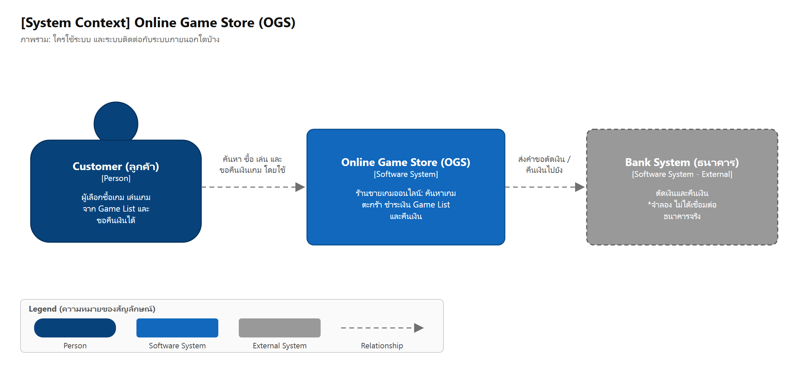
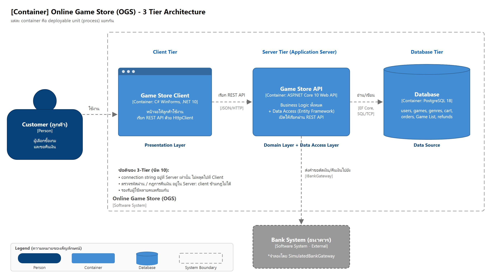
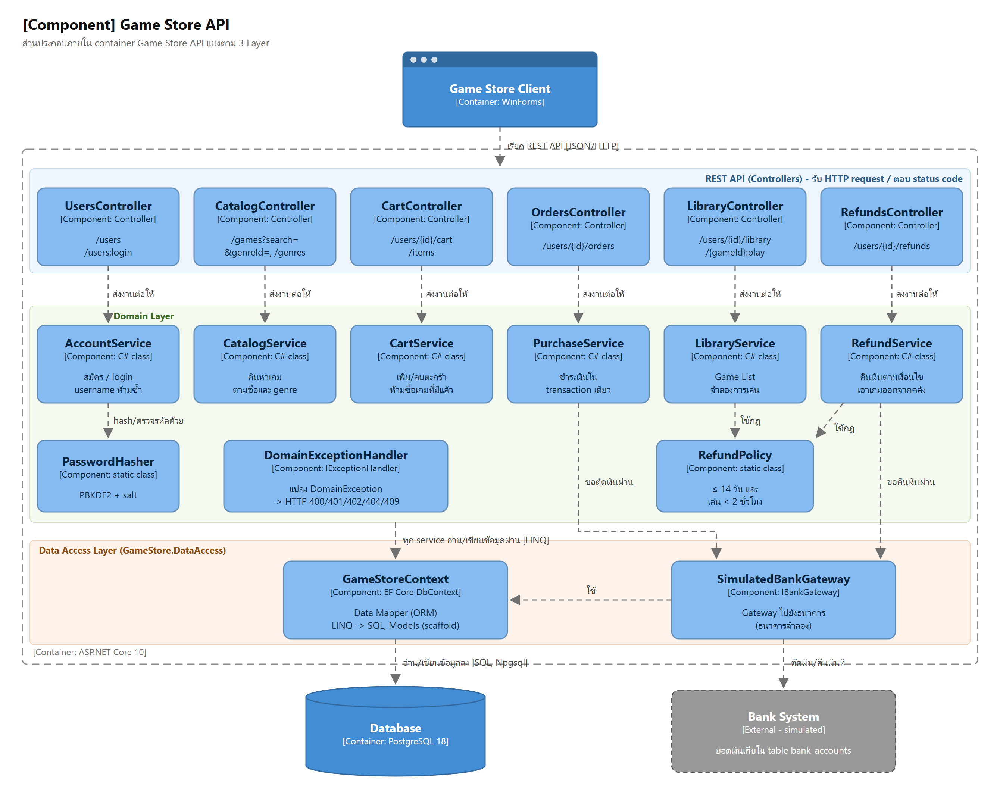
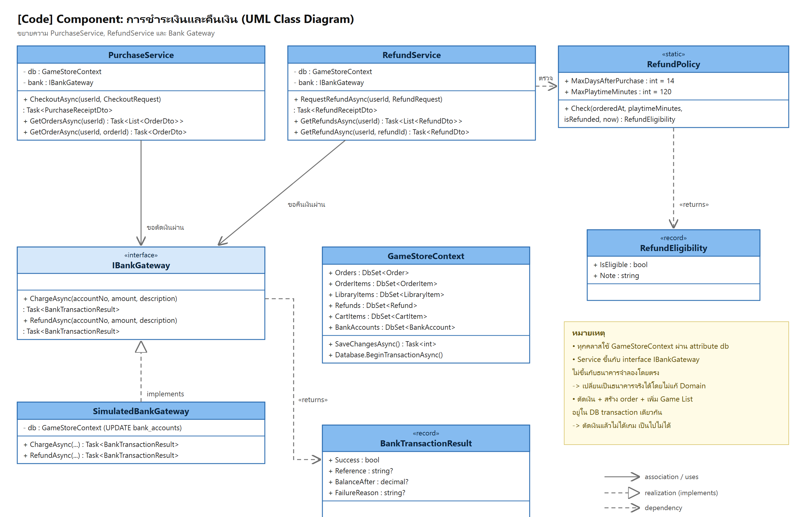
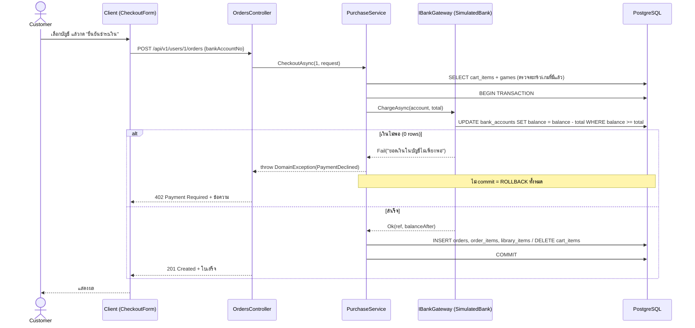

# 2. Architectural Design

## 2.1 การตัดสินใจทางสถาปัตยกรรม (Architectural Decisions)

อ้างอิงหัวข้อ "Comparing Architectural Decisions" ในชีต 10

| # | ตัวเลือก | เลือก | เหตุผล |
|---|---|---|---|
| 1 | 2-Tier vs **3-Tier** | **3-Tier** (Client / Application Server / Database) | ร้านเกมมีลูกค้าหลายคนพร้อมกัน และมีเงินเข้ามาเกี่ยว ถ้าเป็น 2-Tier ตัว client ต้องรู้ connection string ของ DB ซึ่งหลุดได้ง่าย ใน 3-Tier connection string, การตรวจรหัสผ่าน และกฎทาง business (ราคา, การตัดเงิน, กฎคืนเงิน) อยู่ใน server เท่านั้น client จึงแก้ข้อมูลใน DB ตรง ๆ หรือข้ามกฎไม่ได้ *(ข้อจำกัด: ยังไม่มี token ยืนยันตัวตนในแต่ละ request ดู [04-rest-api.md §4.6](04-rest-api.md#46-ข้อจำกัดที่รู้อยู่แล้ว))* |
| 2 | **Monolith** vs Microservice | **Monolith** (API 1 process, database schema เดียว) | ขอบเขตงานเล็กและทีมเล็ก deploy ง่าย การซื้อเกมต้องตัดเงิน สร้าง order และเพิ่ม Game List ให้สำเร็จพร้อมกัน ถ้าแยกเป็น microservice หลายตัว จะทำ transaction ข้าม service ได้ยาก และมีโอกาส error จากการเรียกข้าม process แต่ภายในยังแบ่ง layer และแยกโฟลเดอร์ชัดเจน (modular monolith) |
| 3 | **Client-Server** vs Peer-to-Peer | **Client-Server** | ข้อมูลเกม ราคา และการซื้อต้องมีแหล่งความจริงเดียวที่เชื่อถือได้ (server) ถ้าเป็น P2P จะป้องกันการโกงราคาหรือการแก้ Game List เองไม่ได้ |
| 4 | **Connection-Oriented** vs Connectionless | **Connection-Oriented** (HTTP บน TCP) | การชำระเงินต้องเชื่อถือได้ ข้อมูลต้องไม่หายและไม่สลับลำดับ ส่วน UDP ไม่รับประกันว่าข้อมูลถึงปลายทาง |

การตัดสินใจเพิ่มเติม

| หัวข้อ | เลือก | เหตุผล |
|---|---|---|
| Messaging | **Synchronous** (request/response) | ลูกค้าต้องรู้ผลการชำระเงินทันที |
| State | **Stateless** REST | server ไม่จำ session ทุก request ระบุ resource ครบในตัว (เช่น `/users/1/cart`) จึงขยายเป็นหลาย server ได้ |
| Web Service | **REST** (ไม่ใช้ SOAP) | message กระชับ (JSON) overhead น้อย และใช้ HTTP method/status code สื่อความหมายได้เลย |
| Technology | WinForms / ASP.NET Core 10 / EF Core 10 / PostgreSQL 18 | ตามที่วิชากำหนด (Presentation Layer เลือก WinForms ให้ตรงกับ Lab ชีต 12) |

## 2.2 3 Layer กับ 3 Tier ในโปรเจกต์นี้

> **3 Layer** = มุมมองว่าโค้ดแบ่งหน้าที่อย่างไร (logical)
> **3 Tier** = มุมมองว่ามีกี่ process/เครื่องตอน deploy (physical) — ชีต 10 หน้า 13

| Layer (logical) | หน้าที่ | Project / โฟลเดอร์ | Tier (physical) |
|---|---|---|---|
| **Presentation Layer** | สื่อสารกับ Customer (หน้าจอ) | `GameStore.Client` (Forms, UI) | Client Tier |
| ↳ ตัวเรียก REST API | แปลงการกดปุ่มเป็น HTTP request | `GameStore.Client/Services` (`RestUtil`, `StoreApi`) | Client Tier |
| **Domain Layer** | Business logic และกฎทั้งหมด | `GameStore.Api/Domain` (Services, Rules) | Server Tier |
| ↳ REST API | รับ request แล้วส่งต่อให้ Domain และแปลงผลเป็น status code | `GameStore.Api/Controllers`, `ErrorHandling` | Server Tier |
| **Data Access Layer** | อ่าน/เขียนข้อมูล และติดต่อระบบภายนอก | `GameStore.DataAccess` (EF `GameStoreContext`, `Models`, `Gateways`) | Server Tier |
| Data Source | แหล่งข้อมูล | PostgreSQL (`gamestore`), ธนาคารจำลอง | Database Tier |
| *(ใช้ร่วมกัน)* | รูปแบบข้อมูล JSON (DTO) | `GameStore.Contracts` | Client + Server |

ทิศทางการเรียก (dependency) เป็นทางเดียวเสมอ:

```
GameStore.Client  ──HTTP/JSON──▶  GameStore.Api (Controllers ▶ Domain Services)  ──▶  GameStore.DataAccess (EF)  ──SQL──▶  PostgreSQL
        └──────────── อ้างอิง GameStore.Contracts (DTO) ทั้งสองฝั่ง ────────────┘
```

- Client **ไม่ได้อ้างอิง** `GameStore.DataAccess` และไม่รู้จัก connection string
- Domain ไม่รู้จัก HTTP: แค่ throw `DomainException` แล้ว `DomainExceptionHandler` จะแปลงเป็น status code ให้

## 2.3 C4 Model

ไฟล์ต้นฉบับ: [c4/workspace.dsl](c4/workspace.dsl) (วางที่ <https://playground.structurizr.com/> เพื่อ generate ภาพ C4 รูปแบบเดียวกับในชีต)

### Level 1 — System Context Diagram


### Level 2 — Container Diagram


### Level 3 — Component Diagram (Game Store API)


### Level 4 — Code Diagram (ส่วนชำระเงินและคืนเงิน)


*(ไฟล์ต้นฉบับ: [uml/code-diagram.puml](uml/code-diagram.puml))*

## 2.4 Data Access Pattern ที่เลือก (ชีต 11)

| Pattern | ใช้ไหม | เหตุผล |
|---|---|---|
| Table Data Gateway (RecordSet/DataTable) | ไม่ใช้ | ไม่ strong type ถ้าพิมพ์ชื่อ column ผิดจะรู้ตอน runtime |
| Row Data Gateway / Active Record | ไม่ใช้ | ถ้าเอาโค้ดเรียก database ไปอยู่ใน object จะปนกับ business logic |
| **Data Mapper (ORM: Entity Framework)** | **ใช้** | object ใน `Models/` ไม่มีโค้ดเรียก DB เลย EF เป็นตัว map class↔table, property↔column, relationship↔foreign key และ LINQ ถูกตรวจ syntax ตั้งแต่ compile time |
| **Gateway** (ไปยังระบบภายนอก) | **ใช้** | `IBankGateway` ซ่อนรายละเอียดการติดต่อธนาคารไว้ ตอนนี้ใช้ `SimulatedBankGateway` ถ้าต่อธนาคารจริงก็แค่เขียน class ใหม่ แล้วเปลี่ยน 1 บรรทัดใน `Program.cs` โดยไม่ต้องแก้ Domain Layer |

> **ข้อควรรู้เรื่อง transaction กับธนาคาร:** ตอนนี้ "ตัดเงินแล้วไม่ได้เกม" เกิดไม่ได้ เพราะธนาคารจำลองเก็บยอดเงินใน database เดียวกัน การตัดเงินจึงอยู่ใน DB transaction เดียวกับการสร้าง order
> ถ้าเปลี่ยนเป็นธนาคารจริง (ระบบภายนอก) การตัดเงินจะอยู่**นอก** DB transaction ของเรา ถ้าตัดเงินสำเร็จแต่บันทึก order ล้มเหลว ต้องสั่ง**คืนเงินชดเชย** (compensating refund) ด้วย `bank.RefundAsync(...)` ใน `PurchaseService`

## 2.5 ลำดับการทำงานของการชำระเงิน (Checkout)



*(ภาพ PNG สำหรับใส่รายงาน: [diagrams/png/sequence-checkout.png](diagrams/png/sequence-checkout.png))*

## 2.6 คุณภาพของระบบที่ออกแบบไว้ (Internal Quality)

- **ความถูกต้องของเงิน:** ใช้ type `money` ใน DB และ `decimal` ใน C# (ไม่ใช้ float); การตัดเงินเป็นคำสั่ง UPDATE เดียวที่มีเงื่อนไข `balance >= amount` จึงไม่มีทางติดลบ แม้หลาย request เข้ามาพร้อมกัน
- **กดซื้อซ้ำพร้อมกัน:** ทดสอบยิง checkout พร้อมกัน 3 ครั้ง ผลคือสำเร็จ 1 ครั้ง (201) ได้ 409 อีก 2 ครั้ง และตัดเงินครั้งเดียว เพราะมี UNIQUE (user_id, game_id) ที่ library_items และ transaction
- **Server down:** `RestUtil` ดัก exception แล้วแสดง "เชื่อมต่อ server ไม่ได้" แทนการค้าง เมื่อ server กลับมาก็ใช้งานต่อได้ทันที (ตาม Todo ท้ายชีต 12)
- **ทดสอบได้:** กฎสำคัญ (`RefundPolicy`, `PasswordHasher`) เป็น pure function จึงมี unit test ใน `GameStore.Tests`
