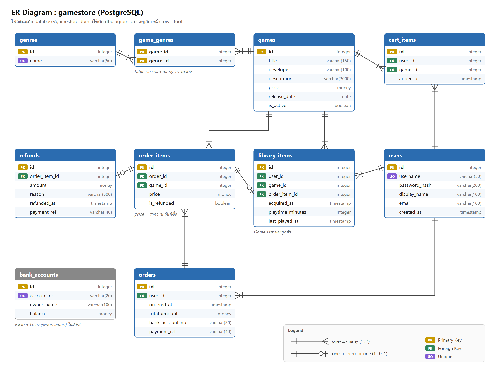
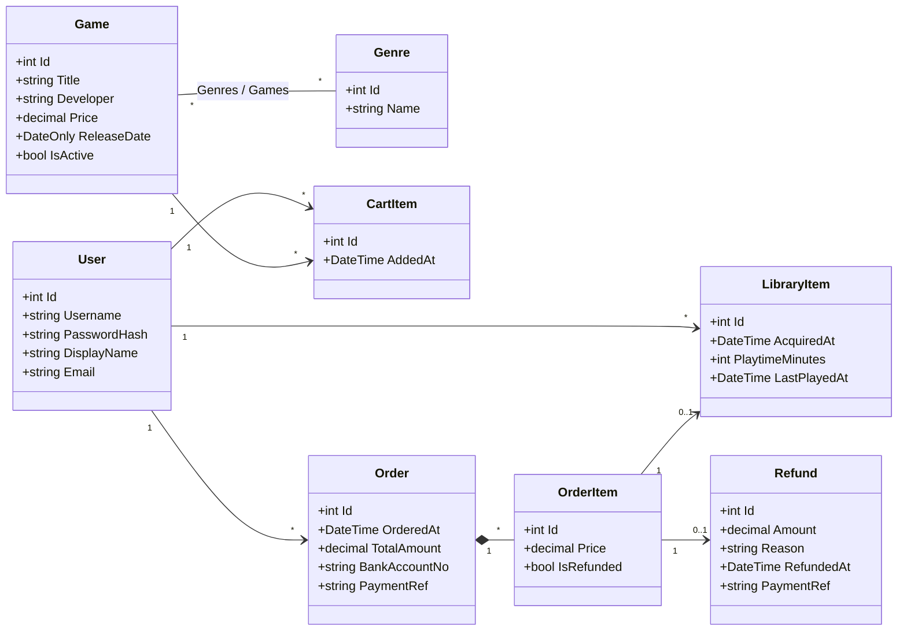

# 3. Database Design และ Data Access Layer

## 3.1 ER Diagram



ไฟล์ต้นฉบับ: [../database/gamestore.dbml](../database/gamestore.dbml) (วางที่ <https://dbdiagram.io/d> เพื่อ generate ภาพแบบในชีต 11)

## 3.2 ตารางทั้งหมด

| Table | เก็บอะไร | หมายเหตุ |
|---|---|---|
| `users` | ลูกค้า | `password_hash` เป็น PBKDF2 ไม่ใช่รหัสจริง, `username` UNIQUE |
| `genres` | แนวเกม | ตาราง lookup เล็ก ๆ กำหนด `id` เอง (เหมือน `items` ในตัวอย่าง Restaurant) |
| `games` | เกมที่ขาย | `is_active = false` = ถอดออกจากร้านแล้ว (ไม่ลบทิ้ง เพราะมีประวัติการซื้ออ้างอิงอยู่) |
| `game_genres` | เกม ↔ แนวเกม | **table กลางของ many-to-many** (1 เกมมีได้หลาย genre, 1 genre มีหลายเกม) |
| `cart_items` | ตะกร้า | UNIQUE (`user_id`, `game_id`) ห้ามใส่เกมเดิมซ้ำ |
| `orders` | คำสั่งซื้อ (1 ครั้งที่จ่ายเงิน) | เก็บบัญชีที่ใช้จ่ายและเลขอ้างอิงธนาคาร เพื่อใช้ตอนคืนเงิน |
| `order_items` | เกมแต่ละเกมในคำสั่งซื้อ | `price` = **ราคา ณ วันที่ซื้อ** ถ้าร้านเปลี่ยนราคาภายหลัง ประวัติจะไม่เปลี่ยน |
| `library_items` | **Game List** | UNIQUE (`user_id`, `game_id`), เก็บเวลาเล่น (`playtime_minutes`) เพื่อใช้ตรวจกฎคืนเงิน |
| `refunds` | การคืนเงิน | `order_item_id` UNIQUE = 1 รายการคืนเงินได้ครั้งเดียว |
| `bank_accounts` | **ธนาคารจำลอง** | แทนระบบภายนอก ไม่มี FK ไปตารางอื่น โค้ดเข้าถึงผ่าน `IBankGateway` เท่านั้น |

## 3.3 หลักการออกแบบที่ใช้ (จากชีต 11)

1. **Surrogate Key**: ทุกตาราง (ยกเว้น `genres`) ใช้ `INTEGER GENERATED ALWAYS AS IDENTITY` เพราะเล็ก เร็ว และ unique แน่นอน ส่วนค่าที่มีความหมายแต่อาจซ้ำหรือเปลี่ยนได้ (username, account_no) ใช้ UNIQUE constraint แทน
2. **Datatype**: เงินใช้ `money` (ทศนิยมฐานสิบ ไม่ใช่ floating point) ส่วนวันเวลาใช้ `timestamp`, วันวางจำหน่ายใช้ `date` และสถานะใช้ `boolean`
3. **Atomic column**: ทุก column เก็บค่าเดียว เช่น genre ของเกมไม่ได้เก็บเป็น `"Action,RPG"` แต่แยกเป็นแถวใน `game_genres`
4. **Many-to-Many**: relational model ไม่มี array จึงต้องมี table กลาง (`game_genres`) ส่วนฝั่ง OO ทาง EF map ให้เป็น collection `Game.Genres` / `Genre.Games` ได้เลย (ชีต 11 หน้า 23)
5. **Foreign Key**: ทุก FK ประกาศแบบ `DEFERRABLE INITIALLY IMMEDIATE` ตามตัวอย่างในชีต
6. **Rows ไม่มีลำดับ**: ทุก query ที่ต้องเรียงจะใช้ `ORDER BY` เสมอ (เช่น ประวัติเรียงตาม `ordered_at DESC`)

## 3.4 Data Access Layer ด้วย Entity Framework (DB-First / Scaffolding)

ทำตามขั้นตอนในชีต 11:

1. สร้าง database ด้วย SQL script ([`database/1_create_database.sql`](../database/1_create_database.sql), [`database/2_create_tables.sql`](../database/2_create_tables.sql))
2. ติดตั้ง NuGet packages ใน `GameStore.DataAccess`:
   `Npgsql.EntityFrameworkCore.PostgreSQL`, `EFCore.NamingConventions` (snake_case), `Microsoft.EntityFrameworkCore.Design` (scaffolding)
3. Scaffold model จาก database:

```bash
cd GameStore.DataAccess
dotnet ef dbcontext scaffold "Host=localhost; Port=5432; Database=gamestore; Username=gamestore_app; Password=GameStore01f2e2fa" Npgsql.EntityFrameworkCore.PostgreSQL --data-annotations --output-dir Models --context GameStoreContext --context-dir . --namespace GameStore.DataAccess.Models --context-namespace GameStore.DataAccess --no-onconfiguring --force
```

4. ส่วนที่เขียนเพิ่มเอง แยกไว้ในไฟล์ `partial` จึง scaffold ใหม่ด้วย `--force` ได้โดยไม่ถูกเขียนทับ
   - [`Models/Model.cs`](../GameStore.DataAccess/Models/Model.cs): เพิ่ม constructor ให้ model (แบบในชีต 11 หน้า 40)
   - [`GameStoreContext.Custom.cs`](../GameStore.DataAccess/GameStoreContext.Custom.cs): constructor ที่รับ connection string + `UseNpgsql` + `UseSnakeCaseNamingConvention` (แบบในชีต 11 หน้า 41)
   - [`Gateways/`](../GameStore.DataAccess/Gateways): Gateway ไปธนาคารจำลอง

### ตัวอย่าง LINQ ที่ใช้จริงในโปรเจกต์

| เทคนิค (ชีต 11) | ใช้ที่ไหน | ตัวอย่าง |
|---|---|---|
| `Where` + query chaining | `CatalogService.SearchGamesAsync` | ต่อ `Where` ทีละเงื่อนไข (ชื่อ, genre) แล้วให้ DB กรองให้ ไม่ได้โหลดทั้ง table |
| `Include` | `PurchaseService.CheckoutAsync` | `db.CartItems.Include(c => c.Game)` |
| `Select` เป็น type ที่ประกาศไว้ | ทุก service | `.Select(g => new GameSummaryDto(...))` |
| `Select` เป็น anonymous object | `LibraryService.GetLibraryAsync` | ใช้ภายใน method แล้วค่อยแปลงเป็น DTO (เพราะ anonymous type return ออกไปไม่ได้) |
| `Any` | `CartService.AddItemAsync` | ตรวจว่ามีเกมแล้วหรือยัง |
| `OrderBy` / `OrderByDescending` | ทุก list | เรียงชื่อเกม เรียงวันที่ซื้อ |
| ปิดท้ายด้วย `ToListAsync` / `SingleOrDefaultAsync` | ทุก query | |
| Add / Remove / Update + Transaction | `PurchaseService`, `RefundService` | `BeginTransactionAsync` → `SaveChangesAsync` → `CommitAsync` |

ระหว่าง run API จะเห็น SQL ที่ EF แปลงจาก LINQ ใน console (log level Information) เช่น

```sql
SELECT g.id, g.title, g.developer, g.price, ...
FROM games AS g
WHERE g.is_active AND g.title ILIKE @pattern ESCAPE '\'
ORDER BY g.title
```

## 3.5 Domain Model ฝั่ง Object (คลาสที่ได้จาก scaffold)



*(ภาพ PNG สำหรับใส่รายงาน: [diagrams/png/domain-model.png](diagrams/png/domain-model.png))*

สังเกตความต่างระหว่าง OO กับ Relational (ชีต 11 หน้า 23): ฝั่ง object `Game.Genres` เป็น collection ที่ชี้ไปยัง `Genre` ได้โดยตรง ส่วนฝั่ง database ต้องมีตาราง `game_genres` คั่นกลาง
